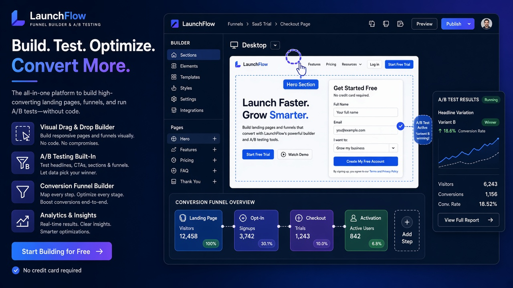
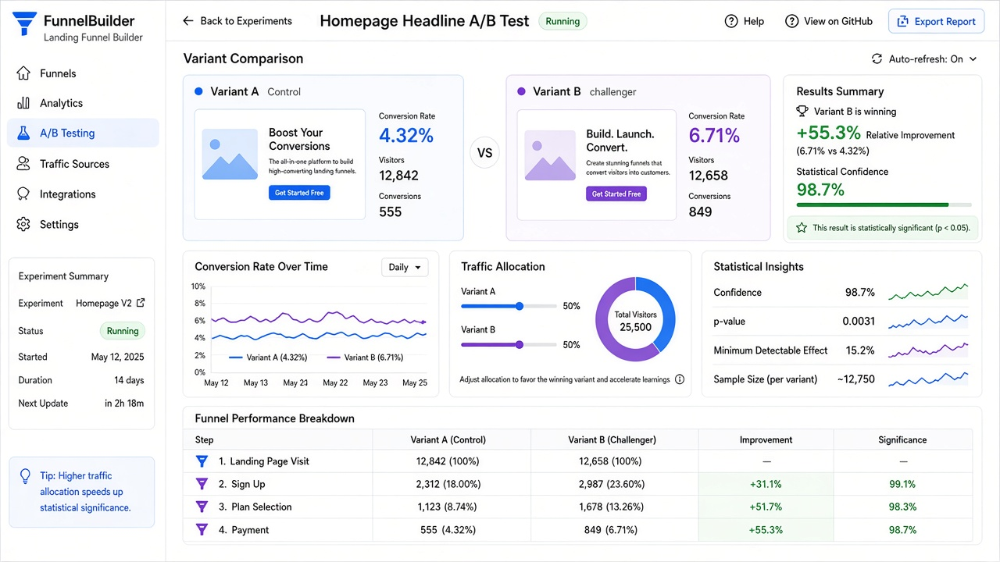

# Landing Page & Funnel Builder — A/B Testing SaaS

### Build Pages. Connect Funnels. Run Experiments. Capture Leads. Optimize Conversions.

<p align="center">
  
</p>

<p align="center">
  <strong>The conversion OS for agencies, marketers, and product teams.</strong><br>
  Modular multi-tenant Laravel platform for landing pages, sales funnels, genuine A/B testing, CRM, automation, and AI copy — with plans you can sell.
</p>

<p align="center">
  <a href="https://imrandev.bd">Portfolio</a> ·
  <a href="https://packagist.org/packages/imrandevbd/">Packages</a> ·
  <a href="mailto:me@imrandev.bd">me@imrandev.bd</a>
</p>

---

## Why teams switch from “random builders + Google Sheets”

Most stacks glue a page builder, a form tool, a CRM, an email tool, and a half-broken A/B plugin. Data doesn’t join. Experiments lie. Agencies juggle client logins forever.

**Landing Funnel Builder** is one commercial product: Organization → Workspace → Project hierarchy, module entitlements, publishable pages, funnel conversion tracking, sticky A/B assignment, lead pipelines, and AI marketing assistance.

### Business opportunities

| Opportunity | How you monetize |
| :--- | :--- |
| **Agency SaaS** | Sell Agency plan with multi-workspace + white-label reports |
| **Usage limits** | Cap pages, visitors, AI credits, experiments per plan |
| **Template marketplace** | Official + community templates as growth & revenue |
| **AI upsell** | Headline / page draft / email copy via `laravel-ai-hub` |
| **Enterprise modules** | Domains, automation, API, attendance (internal) as add-ons |
| **Demo PLG** | Seeded Acme Growth Studio closes design partners fast |

### Time & money saved (estimate)

| Task | Typical time | With this platform | Impact |
| :--- | :--- | :--- | :--- |
| Stand up a campaign landing page | 1–3 days | Hours with templates + editor | Ship same week |
| Wire form → CRM → email | Half day + brittle Zapier | Native capture + workflows | Fewer broken zaps |
| “Is variant B winning?” | Guessing / vanity metrics | Sticky allocation + stats service | Real decisions |
| Client reporting PDF | Manual slides | Unicode PDF exports | Recurring retainers easier |
| Multilingual URLs | Painful redirects | `laravel-universal-slug` | New markets without hacks |

> Agencies running **10+ client workspaces** often save **1–2 FTEs** of “tool babysitting” and win deals by showing live experiments.

---

## Screenshots

<p align="center">
  
</p>

| Surface | Path |
| :--- | :--- |
| Marketing site | `/` Features · Pricing · Use cases · Blog… |
| Organization panel | `/app` |
| Platform admin | `/platform` |
| Page editor | `/editor/pages/{id}` |
| Funnel editor | `/editor/funnels/{id}` |
| Published page | `/p/{subdomain}` · `/sites/{path}` |
| Form capture | `POST /forms/{slug}/submit` |
| API | `/api/v1/...` (Sanctum) |

---

## Complete feature map

### Core builders
- **Landing Page Builder** — JSON sections/components, Livewire/Alpine editor, templates, drafts, publish, versioning
- **Website / multi-page** — projects with multiple pages & navigation
- **Sales Funnel Builder** — steps, connections, conversion tracking, drop-off visibility
- **A/B & experiments** — variants, traffic weights, sticky visitor assignment, events, statistical summary (not “whoever leads after 10 views wins”)
- **Analytics** — visitors, leads, conversions, UTM dimensions, widgets
- **Lead CRM** — contacts, tags, pipelines, form submissions, scoring hooks
- **Marketing automation** — triggers/actions, queued runner, execution history
- **Forms / popups** — builder models + public submit endpoint + spam-aware design
- **Template marketplace** — gallery categories for SaaS, courses, ecommerce, coaches…
- **AI Marketing Assistant** — page drafts, headlines, CTAs, SEO copy (fake/mock without keys)
- **SEO & domains** — meta, OG, universal slugs, custom domain models, verification flow
- **Integrations & API** — adapter stubs, webhooks, API tokens, rate-limit ready
- **Billing** — Free / Starter / Pro / Agency / Enterprise entitlements
- **White-label & media** — branding fields, media library, PDF reports
- **Module Center** — platform + organization enable/disable without deleting data

Docs: `docs/ARCHITECTURE.md` · `MODULES.md` · `API.md` · `PACKAGE-INTEGRATION.md` · `DEMO-SETUP.md`

---

## Tech stack

| Layer | Choice |
| :--- | :--- |
| Backend | Laravel 12 · PHP 8.3+ |
| Admin | Filament 3 (org + platform panels) |
| Frontend | Blade · Livewire · Alpine · Tailwind |
| AI / PDF / Slugs / Perf | Imran Dev BD packages (`ai-hub`, `unicode-pdf`, `universal-slug`, `drutogoti`, …) |
| Auth | Spatie Permission · Sanctum API |
| DB | SQLite demo · MySQL ready |
| CI | **GitHub Actions disabled** |

**Author:** [Imran Ahmed](https://imrandev.bd) · `me@imrandev.bd`

---

## Quick start

```bash
cd landing-page-and-funnel-builder-ab-testing
composer install
touch database/database.sqlite
php artisan migrate --seed
php artisan demo:seed
php artisan serve
```

### Demo credentials

| Role | Email | Password | URL |
| :--- | :--- | :--- | :--- |
| Org Owner (Acme Growth Studio) | `demo@landingfunnel.test` | `password` | `/app` |
| Platform Admin | `platform@landingfunnel.test` | `password` | `/platform` |

Demo includes **5 landing pages**, **3 funnels**, a **running experiment**, and **100 contacts**. Try published page: `/p/acme-home`.

---

## Tests

```bash
php artisan test
```

Covers tenant isolation, experiment allocation, module activation middleware, page publishing.

---

## Competitive positioning (what “complete” means here)

- Not a toy CRUD dashboard — **publish + form submit + sticky A/B** actually work  
- Modules can be sold independently without forking the codebase  
- AI is optional — app runs fully without provider keys  
- Built for **agencies** (multi-workspace) and **product marketers** alike  

---

## License & identity

**Developer:** Imran Ahmed · **Email:** me@imrandev.bd · **Web:** https://imrandev.bd  
Always commit as **Imran Ahmed &lt;me@imrandev.bd&gt;** — never an AI coding agent identity.

---

## 🤝 Let's Connect & Collaborate

I am open to Senior Remote Full-Stack Roles, AI Platform Architecture Contracts, and Enterprise Technical Advisory.

Timezone: UTC+6 (Dhaka / Rangpur, Bangladesh) — Flexible overlap with US, UK, and European business hours.  
Delivery Mode: Async-ready, Slack, Discord, Jira, GitHub, and production-first accountability.

| Channel | Address / Handle | Quick Action |
| :--- | :--- | :--- |
| 🌐 Primary Portfolio | imrandev.bd | [Visit Site ↗](https://imrandev.bd) |
| 📦 Packagist Packages | packagist.org/packages/imrandevbd/ | [View Packages ↗](https://packagist.org/packages/imrandevbd/) |
| 💼 LinkedIn Profile | linkedin.com/in/imranbru99 | [Connect ↗](https://linkedin.com/in/imranbru99) |
| 🐙 GitHub Profile | github.com/imranbru99 | [Follow ↗](https://github.com/imranbru99) |
| 💬 WhatsApp Direct | +880 1576-918420 | [Chat Now ↗](https://wa.me/8801576918420) |
| 📧 Direct Email | me@imrandev.bd | [Send Email ↗](mailto:me@imrandev.bd) |
| 🐦 X (Twitter) | @imrandev_bd | [Follow ↗](https://x.com/imrandev_bd) |
| 📺 YouTube Tech | @ImranDevBD | [Subscribe ↗](https://youtube.com/@ImranDevBD) |
